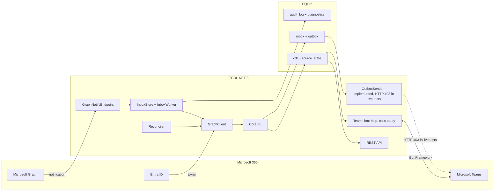
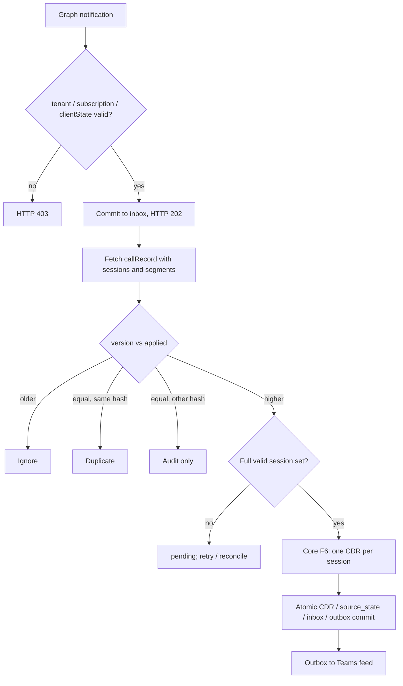

# TCRI design overview

Teams Call Records Integration (TCRI) is a standalone .NET 8 application that turns Microsoft Teams call records into CDRs (call detail records) and exposes them through REST. A Teams bot and activity-feed notifications are part of the design; their status is given in [Verification levels](#verification-levels).

**Status of this document:** a summary of the design as of v0.2.0. Ingestion by reconciliation and by Graph push notifications, and the Teams bot, have been run against a live Microsoft 365 trial tenant; activity-feed delivery failed in all live tests. See [Verification levels](#verification-levels), the [live test protocol](LIVE_TEST_PROTOCOL.md) and [ADR-0001](ADR-0001-subscription-service.md) (subscription management).

## 1. Scope

- Read call records from Microsoft Graph (`communications/callRecords`) with an Entra ID app-only identity and the minimum Graph / RSC permissions.
- Produce **one CDR per session**. Segments inside a session are counted but never summed, because they may overlap.
- Keep every version of a call record that matters: a higher version replaces the stored CDRs, a lower one is ignored, the same version with different content is audited.
- Report through a REST API (`X-TCRI-Key`), a Teams bot (`help`, `calls today`; implemented, verified live in test 3) and activity-feed notifications (sender implemented, not working on the tested tenant).
- Out of scope: media recording, selling call data, any third-party vendor CDR formats.

## 2. Architecture

The dashed arrow shows what does not work on the tested tenant (activity feed); solid arrows were run live (reconciliation, push and the Teams bot).

Three layers: **Host** (HTTP, background services, Teams bot) → **Infrastructure** (EF Core 8 + SQLite, queues, Graph client, subscriptions, reconciliation) → **Core** (pure functions, no I/O).

## 3. Processing of a notification

Key properties:

- The webhook answers `202` only after the notification is durably committed to the `inbox` table.
- The version is checked **before** completeness, so an old incomplete record can never turn a finished call back into "pending".
- An incomplete record never deletes CDRs that were already accepted.
- A missed notification is repaired by the reconciler, which periodically lists recent call records.

## 4. Data model (SQLite, WAL, `synchronous=FULL`)

Eight tables: `cdr`, `source_state`, `inbox`, `outbox`, `rejected`, `audit_log`, `subscription`, `error_log`. All timestamps are ISO 8601 UTC text with exactly seven fractional digits.

Rules implemented by the Core (`src/TeamsCallRecords.Core`):

- Duration = session end minus start in whole seconds, rounded to nearest, a half second rounds up.
- `failed` only when the source carries `failureInfo`.
- `source_hash` = SHA-256 of the canonical JSON of the session; transport annotations (`@odata.*`) are excluded.
- Invalid sessions go to `rejected` with a code and a hash, and never stop processing of the other sessions.

## 5. HTTP surface

| Method | Path | Access |
| --- | --- | --- |
| POST | `/graph/notify` | Graph validation token / clientState check |
| POST | `/graph/lifecycle` | subscription lifecycle events |
| POST | `/api/messages` | Bot Framework token, validated by the Teams SDK (401 without a valid token). Added in v0.2.0 |
| GET | `/api/cdr` | `X-TCRI-Key` |
| POST | `/api/reprocess` | `X-TCRI-Key` (durable job, `202`) |
| GET | `/api/status`, `/health/live`, `/health/ready` | key / open health |

The bot (`Host/Bot`) is a thin layer on the Teams SDK (`Microsoft.Teams.Apps` 2.1.1). `TcriBot` hands the text of a message to `BotCommands`, which has no SDK types, reads the day's statistics through `ICdrReader.GetStatsAsync` and returns a text. "Today" is the local day in `Bot:TimeZoneId` (default `Europe/Kyiv`), converted to a UTC range `[local midnight, next local midnight)`, so a daylight saving day is 23 or 25 hours long. The count is the number of distinct call ids among the CDRs that started in the range, and the duration is the sum over those CDRs (sessions). The bot never calls Graph: it shows only what is already in the database.

## 6. Failure model

- A `POST` to Graph is retried automatically only on `429`. On a timeout, network failure or `5xx` the outcome is *unknown* and the call is not repeated blindly; a subscription creation is reconciled by listing existing subscriptions, an activity-feed notification is closed as `failed` (at-most-once).
- When recovering from an uncertain subscription creation outcome, `EnsureAsync` adopts only a Graph subscription with the matching resource and notification URL. A stored, unexpired subscription with a different URL blocks automatic changes; a conflicting remote subscription may cause HTTP 409. The error is logged, and reconciliation continues independently (ADR-0001 DV-1).
- Queue items have leases; a crashed worker's item is reclaimed. A long reconciliation renews its lease with a compare-and-swap so a stale worker cannot complete it.
- A duplicate webhook is collapsed only while an identical item is still `new`; a repeat after `done` is queued again because the record may have changed.

## 7. Verification levels

| Level | Meaning | Today |
| --- | --- | --- |
| Synthetic verified | unit and integration tests plus the golden examples G01–G11 pass | 507 automated tests, none uses the network; GitHub Actions runs them on every push and pull request |
| Live verified | real Graph app-only token, subscriptions, real call records | Done on one trial tenant, one-to-one audio calls: test 1 (reconciliation) and test 2 (push through a subscription created by the Host) on 2026-10-25, test 3 (Teams bot in a personal chat, with a real call) on 2026-10-26. Evidence and limits: [LIVE_TEST_PROTOCOL.md](LIVE_TEST_PROTOCOL.md) |
| Not live verified | subscription renewal and lifecycle events, RSC, Teams bot in group chats and channels, activity feed | Renewal and lifecycle events: automated tests only. Teams bot: tested in one personal chat only; signed-token authentication cases are not covered by automated tests. Activity feed: HTTP 403 in all live tests, cause not investigated |

The project never reports a result that was not produced.

## 8. Roadmap

1. Core (F6) — implemented.
2. Infrastructure — EF Core + SQLite, queues, Graph client, subscription management (ADR-0001) — implemented.
3. Host — webhook, REST, health — implemented.
4. Live tenant — reconciliation and push verified (v0.1.0), Teams bot verified in a personal chat (test 3, v0.2.0); open: activity-feed 403, signed-token tests for the bot, bot in group chats and channels, observing renewal and lifecycle events live, group and PSTN calls.
