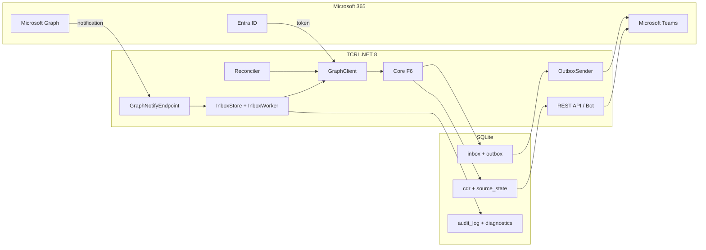
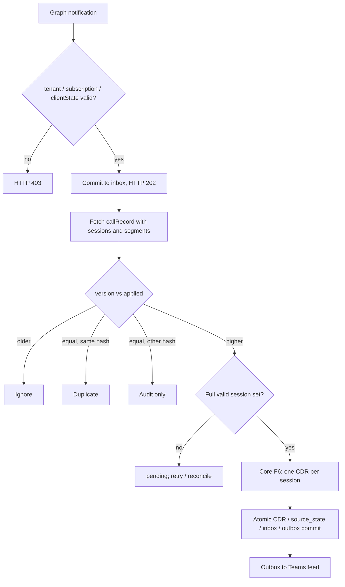

# TCRI design overview

Teams Call Records Integration (TCRI) is a standalone .NET 8 application that turns Microsoft Teams call records into CDRs (call detail records) and exposes them through REST, a Teams bot and activity-feed notifications.

**Status of this document:** a summary of the approved design. Nothing described below as "planned" has been run against a live Microsoft 365 tenant yet. See [Verification levels](#verification-levels).

## 1. Scope

- Read call records from Microsoft Graph (`communications/callRecords`) with an Entra ID app-only identity and the minimum Graph / RSC permissions.
- Produce **one CDR per session**. Segments inside a session are counted but never summed, because they may overlap.
- Keep every version of a call record that matters: a higher version replaces the stored CDRs, a lower one is ignored, the same version with different content is audited.
- Report through a REST API (`X-TCRI-Key`), a Teams bot (`help`, `calls today`) and activity-feed notifications.
- Out of scope: media recording, selling call data, any third-party vendor CDR formats.

## 2. Architecture

Three layers: **Host** (HTTP, bot, background services) → **Infrastructure** (EF Core 8 + SQLite, queues, Graph client, subscriptions, reconciliation) → **Core** (pure functions, no I/O).

## 3. Processing of a notification

Key properties:

- The webhook answers `202` only after the notification is durably committed to the `inbox` table.
- The version is checked **before** completeness, so an old incomplete record can never turn a finished call back into "pending".
- An incomplete record never deletes CDRs that were already accepted.
- A missed notification is repaired by the reconciler, which periodically lists recent call records.

## 4. Data model (SQLite, WAL, `synchronous=FULL`)

Eight tables: `cdr`, `source_state`, `inbox`, `outbox`, `rejected`, `audit_log`, `subscription`, `error_log`. All timestamps are ISO 8601 UTC text with exactly seven fractional digits.

Rules implemented by the Core (`src/TeamsCallRecords.Core`):

- Duration = session end minus start in whole seconds, rounded to nearest, a half second rounds up.
- `failed` only when the source carries `failureInfo`.
- `source_hash` = SHA-256 of the canonical JSON of the session; transport annotations (`@odata.*`) are excluded.
- Invalid sessions go to `rejected` with a code and a hash, and never stop processing of the other sessions.

## 5. HTTP surface

| Method | Path | Access |
| --- | --- | --- |
| POST | `/graph/notify` | Graph validation token / clientState check |
| POST | `/graph/lifecycle` | subscription lifecycle events |
| POST | `/api/messages` | Bot Framework JWT |
| GET | `/api/cdr` | `X-TCRI-Key` |
| POST | `/api/reprocess` | `X-TCRI-Key` (durable job, `202`) |
| GET | `/api/status`, `/health/live`, `/health/ready` | key / open health |

## 6. Failure model

- A `POST` to Graph is retried automatically only on `429`. On a timeout, network failure or `5xx` the outcome is *unknown* and the call is not repeated blindly; a subscription creation is reconciled by listing existing subscriptions, an activity-feed notification is closed as `failed` (at-most-once).
- Queue items have leases; a crashed worker's item is reclaimed. A long reconciliation renews its lease with a compare-and-swap so a stale worker cannot complete it.
- A duplicate webhook is collapsed only while an identical item is still `new`; a repeat after `done` is queued again because the record may have changed.

## 7. Verification levels

| Level | Meaning | Today |
| --- | --- | --- |
| Synthetic verified | unit and integration tests plus the golden examples G01–G11 pass | Core tests written; first CI run pending |
| Live verified | real Graph app-only token, subscriptions, RSC, bot, feed, real call records | not done |

The project never reports a result that was not produced.

## 8. Roadmap

1. Core (F6) — implemented.
2. Infrastructure — EF Core + SQLite, queues, Graph client.
3. Host — webhook, REST, health.
4. Live tenant — subscriptions, bot, activity feed, real call records.
